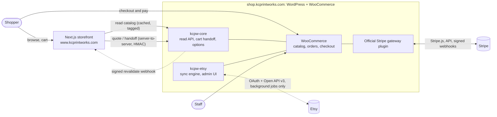
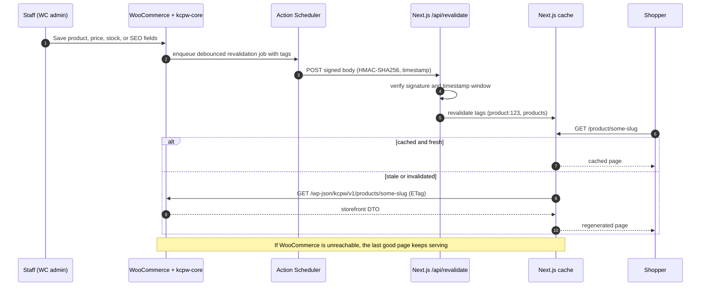

# Architecture

Status: **proposed**, pending the sign-offs listed in [DECISIONS.md](DECISIONS.md).
Anything marked *(assumption)* depends on facts about your current hosting that I could not
inspect; see the open inputs in DECISIONS.md.

## 1. Principles

| # | Principle | Consequence |
|---|---|---|
| P1 | WooCommerce is the system of record for catalog, orders, and payments status | The storefront never computes prices or totals; WooCommerce does. |
| P2 | The shopper path has no dependency on Etsy | Etsy code lives in its own plugin; the storefront has no Etsy credentials; all Etsy calls are background jobs. |
| P3 | Payment truth comes from Stripe, verified server-side | Redirects and client callbacks are informational only. |
| P4 | Nothing changes without a preview, and nothing live changes without approval | Dry-run first, plan-hash apply, approval gates, kill switches. |
| P5 | Fail soft | If WooCommerce or Etsy is slow or down, cached pages keep serving; failures are logged and retried, not surfaced to shoppers. |
| P6 | Own as little payment/security code as possible | Use the official Stripe plugin; ours is a thin handoff layer. |

## 2. System context



Domain names are a proposal *(see ADR-001)*. The shop host serves WordPress admin, the
WooCommerce checkout, REST endpoints, and Stripe webhooks. The apex/`www` host serves the
Next.js storefront.

## 3. Environments

| | Local | Staging | Production |
|---|---|---|---|
| Storefront | `next dev` | Vercel preview or equivalent | `www.kcprintworks.com` |
| WordPress/WooCommerce | Docker Compose, seeded fixture catalog | **Clone** of the current site, separate host | Current live site, **unchanged until launch gate** |
| Stripe | Test mode | Test mode | Live mode (approval gate G6) |
| Etsy | Recorded fixtures only | Real shop, **read scopes only**; no Etsy sandbox is known to exist *(unverified)* | Same app and shop; sync enabled at G6 |
| Email | Mailpit | Sandbox/catch-all | Transactional provider |

Staging must never share a database, Stripe account mode, or webhook secrets with production.

## 4. Components

### 4.1 Storefront (Next.js)

- App Router, TypeScript, server components by default. Product, category, and content pages
  are statically generated with tag-based on-demand revalidation plus a time-based fallback.
- Holds **no secrets that can move money or read Etsy**. Its only secrets: the shared HMAC secret
  for server-to-server calls to `kcpw-core`, and the revalidation secret.
- Browsers never call WordPress APIs directly. Quote and handoff calls go through Next.js
  route handlers that call WordPress server-to-server with HMAC signatures, which avoids CORS
  and hides the WordPress API from the browser.
- Cart lives in the browser (`localStorage`) as **line intents**:
  `{productId, variationId, quantity, options}`. It never stores prices as authority.
- Owns SEO output (metadata, JSON-LD, sitemap, robots, canonical, redirects) using SEO fields
  supplied by WooCommerce; see §5.

### 4.2 WooCommerce

- HPOS (custom order tables) enabled; both first-party plugins declare HPOS compatibility.
- Calculates prices, shipping, tax, discounts, and totals. Owns orders and their statuses.
- Hosts the checkout (see [PAYMENTS-STRIPE.md](PAYMENTS-STRIPE.md)).

### 4.3 `kcpw-core` (first-party plugin)

| Module | Responsibility |
|---|---|
| Storefront read API | `GET /wp-json/kcpw/v1/products`, `/products/{slug}`, `/categories`, `/redirects`. Public, cacheable, ETag/`Last-Modified`. Returns a denormalized storefront DTO (§5.2). |
| Revalidation emitter | Hooks product, variation, price, stock, term, and SEO changes; debounces; sends a signed webhook to Next.js. |
| Cart quote and handoff | Server-to-server endpoints that validate line intents and hand the shopper to WooCommerce checkout. |
| Personalization options | Per-product option schema, server-side validation, price adders, order-item meta. |
| Order lookup | HMAC-signed `GET /orders/{id}?key=` so the storefront can verify order status server-side. |
| Fulfillment view | Channel-agnostic admin list of website and Etsy orders (Step 9). |

### 4.4 `kcpw-etsy` (first-party plugin)

Everything Etsy: OAuth, API client, snapshot store, matcher, preview/apply engine, order
importer, inventory rules, scheduler, admin UI. Detailed in
[ETSY-INTEGRATION.md](ETSY-INTEGRATION.md).

**Isolation rule:** deactivating `kcpw-etsy`, or setting `KCPW_ETSY_ENABLED=false`, must have
zero effect on browsing, cart, checkout, or payments. This is covered by an automated test.

### 4.5 Official Stripe plugin (third-party, pinned)

WooCommerce Stripe Payment Gateway, from the `woocommerce/woocommerce-gateway-stripe`
repository. Updates are applied to staging first, never auto-updated on production.

## 5. Catalog read path and caching

### 5.1 Flow



### 5.2 Storefront DTO

Includes: id, slug, type, status, name, sanitized description HTML, SKU, regular/sale price
and currency, images (URL, alt, dimensions), categories, attributes, variations (id, SKU,
attribute values, price, stock status, image), personalization option schema, availability
(`purchasable`, `stockStatus`, `madeToOrder`, lead time), SEO block (title, meta description,
canonical, Open Graph, robots, optional structured-data overrides), `updatedAt`.

**Excluded by construction:** cost, Etsy IDs, Etsy prices, internal notes, any customer data.
The DTO is validated by a shared schema (zod) on both the contract test and the Next.js side.
This is how separate Etsy and website prices stay separate: the Etsy price never leaves
the admin.

### 5.3 Invalidation and freshness

| Event | Tags revalidated | Latency target |
|---|---|---|
| Product content/SEO/price saved | `product:{id}`, `products` | under 30 s |
| Variation or stock status changed | `product:{id}` | under 30 s |
| Category/term changed | `category:{id}`, `products` | under 60 s |
| Missed webhook (network, deploy) | time-based fallback revalidate (default 1 h), plus nightly full reconcile | 1 h worst case |

A stale price on a page can never cause a wrong charge, because WooCommerce re-prices the
cart at handoff. The cart page re-quotes through `kcpw-core` and shows what checkout will charge.

### 5.4 Failure behavior

| Failure | Shopper impact |
|---|---|
| Etsy down or rate-limited | None. Sync jobs back off; admin shows the error. |
| WooCommerce slow | Cached pages keep serving; cart and checkout degrade. |
| Revalidation webhook lost | Pages stay up to an hour stale, then self-heal. |
| `kcpw-etsy` fatal error | Isolated by plugin boundary; covered by a test that loads the shop with it disabled. |

### 5.5 Performance budget

Targets at p75 on mobile: LCP ≤ 2.5 s, INP ≤ 200 ms, CLS ≤ 0.1. Enforced in CI with
Lighthouse CI against the staging build. Product images go through `next/image`; the DTO is
kept small (no embedded HTML for unrelated products). **Guard:** CI fails if the storefront
package references an Etsy hostname or an Etsy credential variable.

## 6. Data model

WordPress/WooCommerce tables are used as-is. First-party tables (prefix `kcpw_`) are created
by migrations with versioned schema and `dbDelta`.

| Table | Purpose | Key constraints |
|---|---|---|
| `kcpw_etsy_connection` | Single row: shop ID, granted scopes, encrypted tokens, expiry, status | One row per site |
| `kcpw_etsy_listing_snapshot` | Last fetched Etsy listing JSON plus inventory and images | PK `(shop_id, listing_id)` |
| `kcpw_etsy_listing_map` | Etsy listing ID ↔ WC product ID, match method, confidence, state, last base-hash | UNIQUE `(shop_id, listing_id)`; UNIQUE `wc_product_id` |
| `kcpw_etsy_variant_map` | Etsy product ID, offering ID, SKU ↔ WC variation ID, property-value hash | UNIQUE `(shop_id, listing_id, etsy_product_id)` |
| `kcpw_etsy_order_map` | Etsy receipt ID ↔ WC order ID, Etsy status, last synced | **UNIQUE `(shop_id, receipt_id)`** (idempotency) |
| `kcpw_etsy_txn_map` | Etsy transaction ID ↔ WC order item ID | UNIQUE `(shop_id, transaction_id)` |
| `kcpw_field_policy` | Field ownership policy, global and per-product | UNIQUE `(scope, scope_id, field)` |
| `kcpw_inventory_rule` | Stock policy per product/variation | UNIQUE target |
| `kcpw_sync_run` | One row per job run (type, trigger, mode, counts, status) | |
| `kcpw_sync_change` | Per-field before/after for each applied change, enabling undo | FK run |
| `kcpw_sync_plan` | Persisted import preview plans with plan hash and expiry | |
| `kcpw_event_log` | Structured log lines (no secrets), 90-day retention | |
| `kcpw_handoff` | Single-use cart handoff tokens (hashed) and payload, short TTL | |
| `kcpw_webhook_event` | Processed external event IDs (Etsy, if used) for dedupe | UNIQUE event ID |

The Etsy IDs on the mapping tables are also written to product/variation/order meta for
discoverability in WC admin. The tables are the authority; meta is a convenience copy.

## 7. Security

### 7.1 Secrets

| Secret | Lives in | Never in |
|---|---|---|
| Stripe API keys, webhook signing secret | The Stripe plugin's settings on the shop host (test keys on staging; live keys only at G6) | Git, storefront env, logs |
| Etsy client ID / shared secret | `wp-config.php` constants or host env | DB, storefront, git |
| Etsy access/refresh tokens | `kcpw_etsy_connection`, encrypted with libsodium; key in a `wp-config.php` constant outside the DB | Logs, admin UI, API responses |
| Storefront ↔ `kcpw-core` HMAC secret | Host env on both sides | Browser, git |
| Revalidation secret | Host env on both sides | Browser, git |

Secrets are rotated at launch and on staff turnover. `.env*` is gitignored; secret scanning
runs in CI.

### 7.2 Controls

- **PCI scope:** card entry occurs in Stripe-hosted fields; no card data is posted to, logged by,
  or stored on our systems. The expected PCI self-assessment is SAQ A; confirm with Stripe's
  PCI questionnaire before launch. Keep third-party scripts off the checkout page and set a CSP
  limited to the Stripe domains.
- **Server-to-server auth:** HMAC-SHA256 over method, path, timestamp, and body; ±5 minute
  window; constant-time compare; per-request nonce stored briefly for replay protection.
- **Webhook verification:** always on the raw body (Stripe signature; Etsy `webhook-*` headers if
  that feature is used). Do not rely on IP allowlists.
- **Admin:** capability checks plus nonces on every REST action; custom capabilities
  `kcpw_etsy_manage` and `kcpw_etsy_approve_writes`; 2FA required for admin accounts.
- **WordPress hardening:** file editing disabled, XML-RPC off, login rate limiting, WAF, automatic
  updates for core security releases only, off-site backups with a tested restore.
- **Rate limiting** on `quote` and `handoff` route handlers.
- **Privacy:** Etsy buyer data is limited to what fulfillment needs (shipping name/address).
  Etsy's terms restrict how buyer data may be used, and I could not read the current terms from
  this environment, so a review of those terms is a launch gate. WooCommerce privacy
  export/erase tools cover imported orders.

## 8. Observability and operations

- **Logging:** structured logs for sync runs and Etsy requests (method, path, status, duration,
  remaining quota); tokens and PII are scrubbed.
- **Alerts:** failed Stripe webhooks (Stripe Dashboard plus a daily WooCommerce check),
  Etsy `needs_reauth`, repeated sync failures, job overdue, Stripe-versus-WooCommerce amount
  mismatch, uptime on storefront, checkout, and webhook endpoints.
- **Reconciliation (nightly):** every WooCommerce order paid by Stripe has a matching
  PaymentIntent with the same amount; every Etsy receipt in the lookback window has exactly one
  WooCommerce order.
- **Runbooks** (written in Step 10): Stripe webhook failing; refund discrepancy; duplicate-order
  investigation; Etsy token expired; Etsy rate-limited; revalidation not firing; rollback.

## 9. Repository layout (planned)

```
apps/storefront/            Next.js app
packages/contracts/         Shared DTO schemas and types (zod)
wordpress/plugins/kcpw-core/
wordpress/plugins/kcpw-etsy/
wordpress/themes/kcpw-checkout/   Minimal block theme for the checkout host
environments/               Docker Compose, seed data, wp-env config
docs/
.github/workflows/
```

## 10. Brand tokens and accessibility

Official palette: background `#F3EBDD`, text/footer `#111216`, buttons/accent `#FF4A24`,
links/accent `#2B59E6`. Contrast ratios (WCAG 2.x, computed 2026-10-13):

| Pair | Ratio | Verdict for normal text (AA needs 4.5) |
|---|---|---|
| Ink `#111216` on background `#F3EBDD` | 15.81 | Pass |
| Link `#2B59E6` on background | 4.83 | Pass |
| **Ink on accent `#FF4A24`** | **5.58** | **Pass** |
| White on accent | 3.36 | **Fail** (only large text ≥ 24 px, or ≥ 18.66 px bold) |
| Accent on background | 2.83 | **Fail** as text; also below 3:1 for UI component boundaries |
| Background on ink (footer text) | 15.81 | Pass |
| Accent on ink (footer) | 5.58 | Pass |
| Link blue on ink (footer) | 3.27 | **Fail** |

Rules that follow:

1. **Primary buttons use `#111216` text on `#FF4A24`**, not white text. This stays within the
   official palette.
2. Never use accent orange as text or as the only boundary of an input or control on the cream
   background. Use ink for borders and focus rings (2 px solid ink, 2 px offset).
3. Links are blue with an underline (not color alone). In the dark footer, links use the
   background cream or the accent, not blue.
4. Error, success, and sync status are never conveyed by color alone (icon plus text).
5. Target WCAG 2.2 AA for the storefront, the checkout theme, and the Etsy admin screens;
   verified by axe-core in CI plus manual keyboard and screen-reader passes before launch.

Hover, active, and disabled shades are derived tokens defined in Step 1 and checked against the
same table.

## 11. Technical baseline

| Item | Choice | Note |
|---|---|---|
| Node.js | 22 LTS | Next.js 16.4 requires ≥ 20.9 |
| Next.js | Current stable, pinned at scaffold | `latest` was 16.4.0 on 2026-10-13 |
| React | 19.x | `latest` 19.3.0 on 2026-10-13 |
| PHP | 8.2+ *(assumption; verify against host)* | Stripe plugin itself requires ≥ 7.4 |
| WordPress | 6.9+ | Stripe plugin's current minimum is 6.9 |
| WooCommerce | Current stable, HPOS on | |
| Stripe plugin | Pin the version tested on staging | Plugin was at 11.x on 2026-10-13 |
| Jobs | Action Scheduler via system cron + WP-CLI | WP-Cron loopback disabled |
