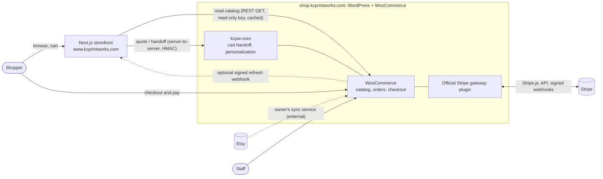
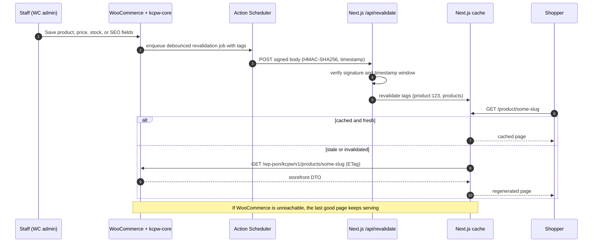

# Architecture

Status: **approved 2026-10-13**; **updated 2026-10-14**: WooCommerce is the single source of truth and the Etsy sync service is external ([ADR-014](DECISIONS.md#adr-014--woocommerce-is-the-source-of-truth-the-sync-service-is-external-and-interchangeable-owner-decision-2026-10-14)); the
storefront reads WooCommerce directly and read-only (ADR-008, revised). See [DECISIONS.md](DECISIONS.md) for the status of each decision.
Anything marked *(assumption)* depends on facts about the current hosting and plugins that could not be
inspected; see the open inputs in DECISIONS.md and [LIVE-SITE-DISCOVERY.md](LIVE-SITE-DISCOVERY.md).
Moving the existing store to the `shop.` host is covered in [MIGRATION-SHOP-DOMAIN.md](MIGRATION-SHOP-DOMAIN.md).

> **Product data flow (updated 2026-10-14, ADR-014).** `Etsy --(owner's sync service: ExportYourStore now, maybe Nembol later)--> WooCommerce --(REST GET, read-only key, cached)--> Next.js`.
> WooCommerce is the single source of truth for products, prices, variations, and orders. We build **no Etsy integration**; the storefront and our plugin never call Etsy or name a sync product
> ([SYNC-INDEPENDENCE.md](SYNC-INDEPENDENCE.md)). The buying path is: cart in the browser -> signed server-to-server handoff to the `kcpw-core` plugin -> WooCommerce checkout with the official Stripe plugin.
> **Built:** the storefront's WooCommerce catalog source ([WOOCOMMERCE-CATALOG.md](WOOCOMMERCE-CATALOG.md)), `kcpw-core` (checkout link, personalization), the storefront handoff and a switchable checkout button.
> **Verified with stand-ins only** (no WordPress, WooCommerce, or Stripe is reachable from the build environment): [CHECKOUT-STAGING-CHECKLIST.md](CHECKOUT-STAGING-CHECKLIST.md) is how the real thing gets proven.

## 1. Principles

| # | Principle | Consequence |
|---|---|---|
| P1 | WooCommerce is the single source of truth for products, prices, variations, orders, and payment status (ADR-014) | The storefront never computes the amount charged; WooCommerce does. Whatever tool fills WooCommerce is interchangeable. |
| P2 | The shopper path has no dependency on Etsy or on any sync service | Nothing we ship calls or names them (`npm run guard`); the storefront reads standard WooCommerce data only. |
| P3 | Payment truth comes from Stripe, verified server-side | Redirects and client callbacks are informational only. |
| P4 | Nothing live changes without approval | Staging first, Stripe in test mode, approval gates, checkout off by default. |
| P5 | Fail soft | If WooCommerce is slow or down, the last good catalog keeps serving; failures are logged and retried, not surfaced to shoppers. |
| P6 | Own as little payment/security code as possible | Use the official Stripe plugin; ours is a thin handoff layer. |

## 2. System context



Domain names are a proposal *(see ADR-001)*. The shop host serves WordPress admin, the
WooCommerce checkout, REST endpoints, and Stripe webhooks. The apex/`www` host serves the
Next.js storefront.

## 3. Environments

| | Local | Staging | Production |
|---|---|---|---|
| Storefront | `next dev` | Vercel preview or equivalent | `www.kcprintworks.com` |
| WordPress/WooCommerce | Docker Compose, seeded fixture catalog | **Clone** of the current site, separate host | Today: the live store on shared hosting at the apex, **unchanged until the launch gate**; afterward: `shop.` host (MIGRATION doc) |
| Stripe | Test mode | Test mode | Live mode (approval gate G6) |
| Etsy sync service | not part of this project | The owner's service, pointed at the **live** store only | unchanged; do not point a second copy of the store at it |
| Email | Mailpit | Sandbox/catch-all | Transactional provider |

Staging must never share a database, Stripe account mode, or webhook secrets with production.

## 4. Components

### 4.1 Storefront (Next.js)

- App Router, TypeScript, server components by default. Product, category, and content pages
  are statically generated with tag-based on-demand revalidation plus a time-based fallback.
- Holds **no secrets that can move money**. Its only secrets: the WooCommerce **read-only** REST key, the shared HMAC secret
  for server-to-server calls to `kcpw-core`, and the revalidation secret (all runtime environment, never in the image).
- Browsers never call WordPress APIs directly. Quote and handoff calls go through Next.js
  route handlers that call WordPress server-to-server with HMAC signatures, which avoids CORS
  and hides the WordPress API from the browser.
- Cart lives in the browser (`localStorage`) as **line intents**:
  `{productId, variationId, quantity, options}`. It never stores prices as authority.
- Owns SEO output (metadata, JSON-LD, sitemap, robots, canonical, redirects) using SEO fields
  supplied by WooCommerce; see §5.

### 4.2 WooCommerce

- HPOS (custom order tables) enabled; both first-party plugins declare HPOS compatibility.
- Calculates prices, shipping, tax, discounts, and totals. Owns orders and their statuses.
- Hosts the checkout (see [PAYMENTS-STRIPE.md](PAYMENTS-STRIPE.md)).

### 4.3 `kcpw-core` (first-party plugin, `wordpress/kcpw-core`)

| Module | Status | Responsibility |
|---|---|---|
| Cart quote and handoff | **Built** | `POST /wp-json/kcpw/v1/cart/quote` and `/cart/handoff` (signed, server to server): validate line intents against WooCommerce, price them, store a single-use 10-minute token, return the checkout link; `/?kcpw_handoff=` rebuilds the WooCommerce cart with WooCommerce's own add-to-cart and redirects to checkout |
| Personalization | **Built** | A "Personalization" tab on the product screen; one JSON schema in product meta; server-side validation identical to the storefront's (33 shared vectors); option charges recomputed from the schema on every totals calculation; values shown in the cart and saved on the order item (readable lines + hidden `_kcpw_personalization`) |
| Checkout link status page | **Built** | WooCommerce > Checkout link: readiness checks (https, secret, permalinks, Stripe active and in test mode, broken setups) |
| Storefront read API (`/products`, `/categories`) | Not built | Replaced for now by the storefront reading WooCommerce's own REST API (ADR-008, revised). A DTO endpoint stays an optimization |
| Revalidation emitter | Not built | The storefront refreshes itself every 2 minutes and on a signed request; a WooCommerce webhook can call it |
| Order lookup, fulfillment view | Not built | Later, if wanted |

It never writes to products (two allowed writes: its own meta key and its own cart/order lines), contains no payment code, and calls no external service;
tests enforce that. See [wordpress/kcpw-core/README.md](../wordpress/kcpw-core/README.md).

### 4.4 Etsy and the sync service

Not ours. The owner's third-party service writes products into WooCommerce; the storefront reads WooCommerce. What the storefront relies on and how to
switch services: [SYNC-INDEPENDENCE.md](SYNC-INDEPENDENCE.md). (A custom `kcpw-etsy` plugin was built and removed on 2026-10-14; see [ETSY-INTEGRATION.md](ETSY-INTEGRATION.md).)

### 4.5 Official Stripe plugin (third-party, pinned)

WooCommerce Stripe Payment Gateway, from the `woocommerce/woocommerce-gateway-stripe`
repository. Updates are applied to staging first, never auto-updated on production.

## 5. Catalog read path and caching

### 5.1 Flow



### 5.2 Storefront DTO

Includes: id, slug, type, status, name, sanitized description HTML, SKU, regular/sale price
and currency, images (URL, alt, dimensions), categories, attributes, variations (id, SKU,
attribute values, price, stock status, image), personalization option schema, availability
(`purchasable`, `stockStatus`, `madeToOrder`, lead time), SEO block (title, meta description,
canonical, Open Graph, robots, optional structured-data overrides), `updatedAt`.

**Normalization rules** (so WooCommerce data quirks never reach the page; details and evidence in
[discovery/INVENTORY.md](discovery/INVENTORY.md)):

- Variation attribute values may be empty, which is WooCommerce's **"Any"**; the cart line carries the shopper's
  chosen options so an "Any" variation still records what was picked.
- Names are entity-decoded; descriptions are the output of WordPress formatting (not raw post content) and are
  sanitized again on the storefront.
- Marketplace-style attributes (Condition, MPN, Primary/Secondary color, Occasion, Holiday, Material) are not exposed
  as shopper-facing details; `made_to_order` sets `availability.madeToOrder`.
- Drafts, private, and hidden products are never emitted; stock counts are ignored for made-to-order items.

**Excluded by construction:** cost, internal notes, any customer data, and any field a sync tool adds for its own use.
The DTO is validated by a shared schema (zod) on both the contract test and the Next.js side.

### 5.3 Invalidation and freshness

| Event | Tags revalidated | Latency target |
|---|---|---|
| Product content/SEO/price saved | `product:{id}`, `products` | under 30 s |
| Variation or stock status changed | `product:{id}` | under 30 s |
| Category/term changed | `category:{id}`, `products` | under 60 s |
| Missed webhook (network, deploy) | time-based fallback revalidate (default 1 h), plus nightly full reconcile | 1 h worst case |

A stale price on a page can never cause a wrong charge, because WooCommerce re-prices the
cart at handoff. The cart page re-quotes through `kcpw-core` and shows what checkout will charge.

### 5.4 Failure behavior

| Failure | Shopper impact |
|---|---|
| Sync service down or behind | None. The shop shows whatever WooCommerce holds. |
| WooCommerce slow | Cached pages keep serving; cart and checkout degrade. |
| Revalidation webhook lost | Pages stay up to an hour stale, then self-heal. |
| `kcpw-core` fatal error or deactivated | Browsing and the catalog are unaffected (the storefront reads WooCommerce's REST API); Checkout reports "not reachable" and keeps the cart. |

### 5.5 Performance budget

Targets at p75 on mobile: LCP ≤ 2.5 s, INP ≤ 200 ms, CLS ≤ 0.1. Enforced in CI with
Lighthouse CI against the staging build. Product images go through `next/image`; the DTO is
kept small (no embedded HTML for unrelated products). **Guard:** CI fails if the storefront
package references an Etsy hostname, an Etsy credential variable, or a sync product by name.

## 6. Data model

WordPress/WooCommerce tables are used as-is. First-party tables (prefix `kcpw_`) are created
by migrations with versioned schema and `dbDelta`.

> **As built:** one table, `{prefix}kcpw_handoff` (pending cart handoffs; created by `Wp/Schema.php`). Everything else lives in standard WooCommerce structures:
> product meta `_kcpw_option_schema` (personalization setup, JSON), optional `_kcpw_made_to_order`, and order-item meta (readable lines + `_kcpw_personalization`).

| Table | Purpose | Key constraints |
|---|---|---|
| `kcpw_handoff` | Single-use cart handoff tokens (stored as a hash) and the validated line intents, TTL 10 minutes, purged daily | PK token hash |

## 7. Security

### 7.1 Secrets

| Secret | Lives in | Never in |
|---|---|---|
| Stripe API keys, webhook signing secret | The Stripe plugin's settings on the shop host (test keys on staging; live keys only at G6) | Git, storefront env, logs |
| WooCommerce read-only REST key | The storefront container's environment (VPS `.env`, mode 600) | Image, git, browser, logs |
| Storefront ↔ `kcpw-core` HMAC secret (`KCPW_HANDOFF_SECRET`) | `wp-config.php` on the shop, container environment on the storefront | Browser, git, database |
| Revalidation secret | Host env on both sides | Browser, git |

Secrets are rotated at launch and on staff turnover. `.env*` is gitignored; secret scanning
runs in CI.

### 7.2 Controls

- **PCI scope:** card entry occurs in Stripe-hosted fields; no card data is posted to, logged by,
  or stored on our systems. The expected PCI self-assessment is SAQ A; confirm with Stripe's
  PCI questionnaire before launch. Keep third-party scripts off the checkout page and set a CSP
  limited to the Stripe domains.
- **Server-to-server auth:** HMAC-SHA256 over method, route, timestamp, nonce, and body hash; ±5 minute
  window; constant-time compare; per-request nonce stored briefly for replay protection (`Auth\RequestSigner`; shared test vectors with the storefront).
- **Webhook verification:** always on the raw body (Stripe's signature, handled by the official plugin; the storefront's refresh endpoint uses HMAC). Do not rely on IP allowlists.
- **Admin:** capability checks plus nonces on every admin action (the product tab checks `edit_post` and a nonce); 2FA required for admin accounts.
- **WordPress hardening:** file editing disabled, XML-RPC off, login rate limiting, WAF, automatic
  updates for core security releases only, off-site backups with a tested restore.
- **Rate limiting** on `quote` and `handoff` route handlers.
- **Privacy:** customer data stays in WooCommerce. The storefront stores nothing about shoppers except the cart in their own browser; the handoff table holds line intents (no names, addresses, or payment data).
  Personalization text is customer-supplied content and is escaped everywhere it is shown.

## 8. Observability and operations

- **Logging:** the storefront logs why a handoff failed (no secrets, no customer data); WooCommerce keeps its own logs.
- **Alerts:** failed Stripe webhooks (Stripe Dashboard plus a daily WooCommerce check), Stripe-versus-WooCommerce amount
  mismatch, uptime on storefront, checkout, and webhook endpoints.
- **Reconciliation (nightly, later):** every WooCommerce order paid by Stripe has a matching
  PaymentIntent with the same amount.
- **Runbooks** (written in Step 10): Stripe webhook failing; refund discrepancy; duplicate-order
  investigation; handoff link not working (secret mismatch, plugin inactive); revalidation not firing; rollback.

## 9. Repository layout (planned)

```
apps/storefront/            Next.js app
packages/contracts/         Shared DTO schemas and types (zod)
wordpress/kcpw-core/              Checkout link + personalization plugin (built)
wordpress/themes/kcpw-checkout/   Minimal block theme for the checkout host (planned)
environments/               Docker Compose, seed data, wp-env config
docs/
.github/workflows/
```

## 10. Brand tokens and accessibility

Official palette: background `#F3EBDD`, text/footer `#111216`, buttons/accent `#FF4A24`,
links/accent `#2B59E6`. Contrast ratios (WCAG 2.x, computed 2026-10-13):

| Pair | Ratio | Verdict for normal text (AA needs 4.5) |
|---|---|---|
| Ink `#111216` on background `#F3EBDD` | 15.81 | Pass |
| Link `#2B59E6` on background | 4.83 | Pass |
| **Ink on accent `#FF4A24`** | **5.58** | **Pass** |
| White on accent | 3.36 | **Fail** (only large text ≥ 24 px, or ≥ 18.66 px bold) |
| Accent on background | 2.83 | **Fail** as text; also below 3:1 for UI component boundaries |
| Background on ink (footer text) | 15.81 | Pass |
| Accent on ink (footer) | 5.58 | Pass |
| Link blue on ink (footer) | 3.27 | **Fail** |

Rules that follow:

1. **Primary buttons use `#111216` text on `#FF4A24`**, not white text. This stays within the
   official palette.
2. Never use accent orange as text or as the only boundary of an input or control on the cream
   background. Use ink for borders and focus rings (2 px solid ink, 2 px offset).
3. Links are blue with an underline (not color alone). In the dark footer, links use the
   background cream or the accent, not blue.
4. Error, success, and sync status are never conveyed by color alone (icon plus text).
5. Target WCAG 2.2 AA for the storefront, the checkout theme, and the plugin's admin screens;
   verified by axe-core in CI plus manual keyboard and screen-reader passes before launch.

Hover, active, and disabled shades are derived tokens defined in Step 1 and checked against the
same table.

## 11. Technical baseline

| Item | Choice | Note |
|---|---|---|
| Node.js | 22 LTS | Next.js 16.4 requires ≥ 20.9 |
| Next.js | Current stable, pinned at scaffold | `latest` was 16.4.0 on 2026-10-13 |
| React | 19.x | `latest` 19.3.0 on 2026-10-13 |
| PHP | 8.2+ *(assumption; verify against host)* | Stripe plugin itself requires ≥ 7.4 |
| WordPress | 6.9+ | Stripe plugin's current minimum is 6.9 |
| WooCommerce | Current stable, HPOS on | |
| Stripe plugin | Pin the version tested on staging | Plugin was at 11.x on 2026-10-13 |
| Jobs | Action Scheduler via system cron + WP-CLI | WP-Cron loopback disabled |
