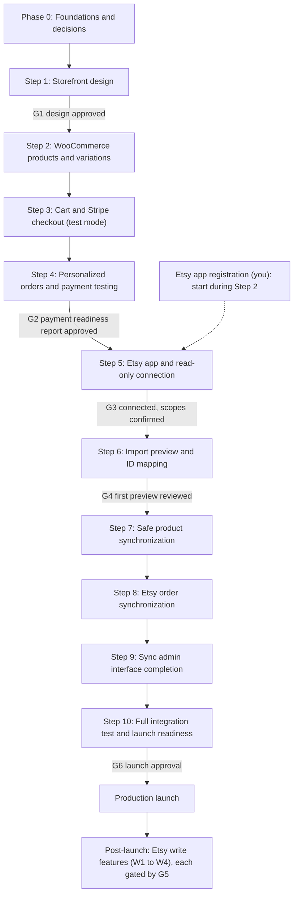

# Implementation Plan

Status: **proposed**. Follows the build order in your brief (Steps 1 to 10) and adds a Phase 0 for
foundations and a post-launch track for Etsy write features. Effort is given as relative sizes
(S ≈ days, M ≈ 1 to 2 weeks, L ≈ 2 to 4 weeks, for one developer); I deliberately give no calendar
dates because the Etsy approval time and your review turnaround are outside my control.

## 1. Overview

**One recommended deviation from your order:** *submit* the Etsy developer-app registration early
(during Step 2) because approval time is unknown. The *engineering* order is unchanged. Steps 5 and 6
can also begin against recorded fixtures or CSV exports while approval is pending.

## 2. Approval gates

Nothing below happens without your explicit go-ahead.

| Gate | Needed before | You approve |
|---|---|---|
| G0 | Any work against a real WordPress host | A staging clone exists; production is not touched |
| G1 | Step 2 | Storefront design |
| G2 | Step 5 | Payment readiness report (test mode only) |
| G3 | Step 6 against real data | Etsy app registered; you completed the read-only OAuth consent |
| G4 | Any write to WooCommerce from Etsy data | The first import preview, item by item |
| G5 | Any Etsy **write** scope or write call (post-launch) | Each write feature, then each listing it touches |
| G6 | Any production change | Live Stripe keys and webhook, Apple Pay domain, DNS cutover, redirects, Etsy sync enabled in production, launch checklist signed |

## 3. Phase 0 — Foundations and decisions (size: S–M)

| Task | Output |
|---|---|
| Resolve the open inputs and sign-offs in [DECISIONS.md](DECISIONS.md) | Decisions recorded |
| Scaffold the monorepo (layout in ARCHITECTURE §9), TypeScript, lint, formatting, commit hooks | Repo skeleton |
| CI: lint, typecheck, unit tests, PHPUnit, Playwright, axe, Lighthouse CI, secret scanning, dependency audit, and the guard "no Etsy hostname or credential in `apps/storefront`" | Green pipeline on an empty app |
| Local environment: Docker Compose with WordPress, WooCommerce, MariaDB, Mailpit, seeded fixture catalog (simple, variable, personalized, made-to-order, stock-limited) | `make up` works |
| Staging: **clone** of the current WooCommerce site on a separate host with scrubbed customer data, test-mode Stripe only | G0 |
| Secrets management and environment variable inventory | Documented, no secrets in git |

Exit: pipeline green, local and staging environments reachable, decisions recorded.

## 4. Step 1 — Complete the Next.js storefront design (size: L)

- Design tokens from the brand palette with the contrast rules in ARCHITECTURE §10; derived
  hover, active, disabled, and focus tokens verified against the contrast table.
- Information architecture and routes, **preserving existing URL structure** where it exists
  (`/product/{slug}`, `/product-category/{slug}`, content pages) and a 301 map for anything that
  changes.
- Templates: home, shop and category listing with filters, product page (gallery, variation
  selector, **personalization form**, availability and lead-time messaging), cart, order-complete,
  content pages, search, 404, footer and legal.
- Built on typed fixture data behind the same data-access interface that will later call WooCommerce,
  so design is not blocked on the backend.
- SEO: metadata API, JSON-LD (Product, BreadcrumbList, Organization), sitemap, robots, canonical.
- Accessibility baseline (WCAG 2.2 AA) and Lighthouse budgets in CI.

Exit (**G1**): you approve the design at mobile, tablet, and desktop widths.

## 5. Step 2 — Connect WooCommerce products and variations (size: M–L)

- `kcpw-core` read API and DTO schema in `packages/contracts`.
- Next.js data layer: server fetch with cache tags, time-based fallback, build-time static generation
  of products and categories, on-demand revalidation endpoint with HMAC verification.
- Revalidation emitter in `kcpw-core` (debounced, via Action Scheduler).
- Product variations, price ranges, stock status, made-to-order messaging, images, attributes,
  categories, SEO fields (from the SEO plugin in use), and the personalization schema in the DTO.
- Draft/preview mode for unpublished products. Sitemap and redirects generated from WooCommerce data.
- Performance and resilience tests: serve with WooCommerce stopped; latency from save to
  visible update; Lighthouse budgets.
- **Parallel, owner action:** register the Etsy developer app (personal access) and share the status.

Exit: every product type renders from staging data; invalidation under 30 s; pages survive a
WooCommerce outage.

## 6. Step 3 — WooCommerce cart and Stripe-powered checkout (size: L)

- Next.js cart (line intents), quote endpoint, handoff endpoint, token store (PAYMENTS §4).
- Personalization validation and pricing in `kcpw-core` (PAYMENTS §5).
- `kcpw-checkout` block theme with brand tokens; WooCommerce Checkout block; order-received page.
- Install the official Stripe plugin pinned to a tested version on **staging with test keys**; enable
  card, Apple Pay, Google Pay; register the staging webhook and Apple Pay domain (test mode).
  Test keys come from you, and each change to the Stripe test account is listed and approved by
  you first. Live mode is untouched until G6.
- Branded WooCommerce emails; transactional email provider on staging.
- **Spikes (time-boxed):** (a) confirm the plugin's idempotency and webhook behavior from Stripe's
  request logs; (b) test whether a filtered return URL is safe (PAYMENTS §8); (c) confirm
  restricted-key support; (d) confirm the Apple Pay flow on the shop host.
- If a spike shows the hybrid approach cannot meet the requirements, stop and bring ADR-002 back
  to you with evidence before building anything in option C.

Exit: a test-mode purchase completes end to end from `www` through to a Processing order and email.

## 7. Step 4 — Test personalized orders and payment processing (size: M)

Run the whole plan in PAYMENTS §11: payment methods, duplicates and webhooks, totals matrix,
refunds, personalization and tampering. Fix defects, then write the **payment readiness report** (results,
open issues, plugin version, configuration inventory).

Exit (**G2**): report approved. No live Stripe change is made at this step.

## 8. Step 5 — Register and connect the Etsy Seller App (size: M, plus external wait)

- Owner: complete registration (personal access) and supply redirect URIs; confirm real rate limits
  shown in the developer portal.
- Vendor Etsy's OpenAPI spec into the repo; resolve every "To verify" item in
  ETSY-INTEGRATION §16 against it and record the results.
- `kcpw-etsy`: OAuth connect/disconnect, encrypted token store, refresh job, API client with
  read-only guard, rate limiter, circuit breaker, structured logging.
- Connection status panel (first piece of the admin UI).
- Review Etsy's current API terms: attribution, data retention, buyer data.
- Chaos test baseline: with Etsy blocked, the shop passes the end-to-end purchase.

Exit (**G3**): connected on staging with read scopes only; `needs_reauth` and refresh paths tested.

## 9. Step 6 — Etsy product import preview and ID mapping (size: L)

- Snapshot job for listings, inventory, and images; mapping tables.
- Matcher (tiers in ETSY §6), conflict detector, plan generator with stable plan hashing.
- Import-preview screen and the **manual matching tool**, including variation mapping grid.
- CSV adapter as a fallback source.
- This step makes **no write to WooCommerce products**.

Exit (**G4**): you review the first real preview: counts of would-create, would-link, would-update,
conflicts, and unmatched, and agree on the field-policy defaults.

## 10. Step 7 — Safe product synchronization (size: L)

- Field-ownership engine with global and per-product policies; three-way conflict detection.
- Apply engine: batches, resumable, per-field change log, stale-item detection, **undo**.
- Image sideloading with dedupe. Draft-only creation for unmatched listings.
- Inventory rule storage with the `made_to_order` default and drift reporting (no auto-write).
- Scheduled snapshot refresh and plan generation; retries, backoff, rate-limit budget, logs, alerts.
- Tests: apply never touches Woo-owned or SEO fields; preview and apply agree; undo restores;
  concurrent runs do not duplicate.

Exit: first approved apply on staging, undo demonstrated, scheduled refresh stable for 48 hours.

## 11. Step 8 — Etsy order synchronization (size: M–L)

- Receipt poller with watermark and overlap; unique-receipt idempotency; transaction mapping.
- WooCommerce order creation as externally paid (`kcpw_etsy`), email suppression, no tax
  recalculation, integer money math, currency guard, unmapped-item handling, needs-attention queue.
- Personalization and buyer note import; shipment status refresh; cancellation handling.
- Etsy-sale stock decrement for items whose rule requires it.
- Analytics separation for Etsy-sourced orders.
- Tests: triple and concurrent import → one order; no PaymentIntent path for Etsy orders; the order
  total equals the Etsy receipt; personalization matches the Etsy receipt on real samples.

Exit: a week of staging imports with every Etsy receipt matched to exactly one order (reconciliation report).

## 12. Step 9 — Synchronization admin interface (size: M)

Complete the screens in ETSY §13: dashboard, products, conflicts, orders, inventory, history and
revert, settings. The consolidated **fulfillment view** (website and Etsy orders, channel filter,
personalization shown prominently, packing-slip print). Accessibility audit with axe-core and
keyboard and screen-reader walkthroughs.

Exit: all items in your brief's admin list are present and operable by keyboard.

## 13. Step 10 — Full integration test and launch readiness (size: M–L)

| Area | Activities |
|---|---|
| End to end | Browse → personalize → cart → handoff → pay (card, Apple Pay, Google Pay) → email → refund |
| Resilience | Etsy blocked, Etsy 429/5xx, WooCommerce restart during revalidation, lost webhooks |
| Performance | Lighthouse budgets, load test of the storefront and the handoff endpoint, sync jobs running during a load test (checkout latency must not degrade) |
| Security | Dependency and secret scans, authorization review of every REST route, CSP, tampering suite, penetration-style checks on handoff and uploads |
| Accessibility | axe, keyboard, screen reader on storefront, checkout, emails, admin |
| Data | Backup and restore drill; migration rehearsal on a fresh staging clone |
| SEO | URL parity, 301 map, canonical, sitemap, structured data, `noindex` on the shop host except where needed |
| Compliance | Etsy API terms review, privacy policy updates, PCI self-assessment |
| Soak | At least 7 days on staging with real read-only Etsy sync |
| Docs | Runbooks (ARCHITECTURE §8), rollback plan, on-call contact |

## 14. Launch checklist (Gate G6, all explicit approvals)

- [ ] Launch checklist signed by you; rollback plan written and rehearsed.
- [ ] Production backup taken and restore verified.
- [ ] Stripe: live keys entered by you; live webhook endpoint registered and signed-event test
      delivered; Apple Pay domain registered for the production shop host; statement descriptor
      reviewed; Stripe email receipts decision applied; live smoke test with a low-value order and refund.
- [ ] Transactional email domain authenticated (SPF, DKIM, DMARC).
- [ ] DNS and routing changes applied by you or with your approval; TLS valid on `www` and the shop host.
- [ ] 301 redirect map live; sitemap submitted; analytics verified.
- [ ] Production secrets rotated from staging values.
- [ ] Etsy: production redirect URI registered; consent completed by you; sync enabled in read-only
      mode; first production preview reviewed (G4 again, on production data).
- [ ] Monitoring and alerts on; first-week daily reconciliation review scheduled.

## 15. Post-launch — Etsy write features (each behind G5)

| Feature | Requires | Safety |
|---|---|---|
| W1 tracking push | `transactions_w` | Shadow mode first; single-receipt test |
| W2 stock and price push | `listings_w` | Read-modify-write inventory with a diff and shadow mode; per-product opt-in |
| W3 draft creation | `listings_w` | Drafts only; you publish in Etsy |
| W4 listing updates | `listings_w` | Per-listing diff and approval; prior state snapshotted |

## 16. Risk register

| ID | Risk | Likelihood / impact | Mitigation |
|---|---|---|---|
| R1 | Etsy API access delayed or denied, or app banned after a commercial request | Medium / High | Apply for personal access only; accurate description; apply early; CSV adapter fallback |
| R2 | Etsy rate limits lower than expected | Medium / Medium | Read real limits from the portal; request budgeting; `includes`; incremental polling |
| R3 | Etsy docs or behavior differ from this plan's assumptions | High / Medium | Vendor spec and verify every item in Step 5; contract tests; weekly spec diff |
| R4 | Hybrid checkout looks different from the storefront | High / Medium | Branded block theme, review at G1 and G2; option C as contingency |
| R5 | Plugin update breaks checkout | Medium / High | Pin versions; staging-first updates; automated checkout smoke test on every update |
| R6 | Apple Pay fails because the domain is registered on the wrong host | Medium / Medium | Register the shop host; test on real devices; checklist item |
| R7 | Sync workload slows shopper-facing PHP | Medium / High | System cron via WP-CLI, concurrency 1, small batches, off the web request path; load test in Step 10 |
| R8 | Etsy orders inflate website revenue and tax reports | High / Medium | `created_via`/source flags; reporting filter in Step 9; documented in ADR-004 |
| R9 | Personalization tampering or abuse | Medium / High | Server-side schema validation and pricing; tamper suite; escaped output; upload hardening |
| R10 | SEO regression at cutover | Medium / High | URL parity, 301 map, preserved SEO fields, staging crawl comparison |
| R11 | Oversell on shared-stock items | Low / Medium | Opt-in only, safety buffer, alerts |
| R12 | Etsy buyer data compliance | Medium / Medium | Minimal fields, no email by default, terms review as a launch gate |
| R13 | Email deliverability | Medium / Medium | Transactional provider, SPF, DKIM, DMARC, test before launch |
| R14 | Brand accent fails contrast in some pairings | Certain / Low | Rules in ARCHITECTURE §10 applied from Step 1 |
| R15 | Hosting constraints (no system cron, old PHP, shared host) | Unknown / High | Confirm in Phase 0; budget a host change if needed |

## 17. Definition of done for the whole project

Every requirement in your brief is traceable to a test or a gate: PAYMENTS §2 for payments; ETSY §1 to
§14 for the integration; ARCHITECTURE §5 for speed and resilience. Production runs only after G6.
