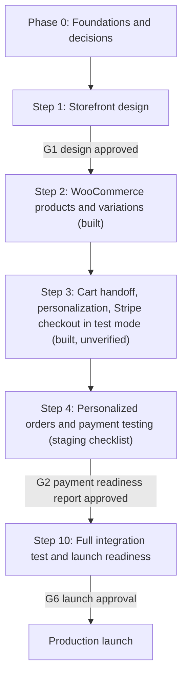

# Implementation Plan

Status: **architecture approved 2026-10-13; revised 2026-10-14 (ADR-014)**. Live progress is tracked in [../PROJECT_STATUS.md](../PROJECT_STATUS.md). Effort is given
as relative sizes (S ≈ days, M ≈ 1 to 2 weeks, L ≈ 2 to 4 weeks, for one developer); there are deliberately no calendar dates.

> **Revision 2026-10-14.** The owner synchronizes Etsy into WooCommerce with a third-party service (ExportYourStore now, maybe Nembol later), so **the former Steps 5 to 9
> (custom Etsy app, import preview, synchronization, order sync, sync admin) and the post-launch Etsy write features are removed.** The priority is now the buying path:
> product integration (Step 2), personalization and cart handoff and Stripe checkout (Steps 3 and 4), then launch readiness (Step 10). Etsy is out of scope except for keeping the
> storefront independent of whichever service is used ([SYNC-INDEPENDENCE.md](SYNC-INDEPENDENCE.md)).

## 1. Overview

**Running in parallel from now:** the read-only live-site discovery
([LIVE-SITE-DISCOVERY.md](LIVE-SITE-DISCOVERY.md)), which settles the remaining personalization questions and the final migration plan
([MIGRATION-SHOP-DOMAIN.md](MIGRATION-SHOP-DOMAIN.md)).

## 2. Approval gates

Nothing below happens without your explicit go-ahead.

| Gate | Needed before | You approve |
|---|---|---|
| G0 | Any work against a real WordPress host | Discovery inventory reviewed; a staging clone exists; production is not touched |
| G1 | Step 2 | Storefront design |
| G2 | Step 10 | Payment readiness report (test mode only) |
| G3 | Switching checkout on in any container | The owner turns it on in the staging `.env`, after the staging checklist; never in a production image |
| G3b | Letting shoppers write reviews | Update `kcpw-core` to 0.2.0 on **staging** first ([REVIEWS-STAGING-CHECKLIST.md](REVIEWS-STAGING-CHECKLIST.md)), then `REVIEWS_SUBMIT_ENABLED=true` in the staging `.env`; the live site's plugin is a separate approval (G6). Reviews are only ever saved as pending |
| G6 | Any production change | Live Stripe keys and webhook, Apple Pay domain, DNS (including creating `shop.`), SSL, cutover per MIGRATION §9, redirects, launch checklist signed |

### Navigation, content and reviews (owner-approved plan v2, 2026-10-14; ADR-016, ADR-017)

Built after Step 3 on the owner's instruction, in stages that were each tested: (1) categories as a tree, the header Shop | Game Cases | Personalized Gifts | New
Arrivals | Blog | Cart (categories configurable without a rebuild), Featured Products, publication-date New Arrivals; (2) the blog, Our Story and Contact read
from WordPress with a hardened sanitizer, SEO and sitemap; (3) approved reviews from WooCommerce, with rating data; (4) moderated review submission
through `kcpw-core` 0.2.0, off by default; (5) documentation ([WORDPRESS-CONTENT-AND-REVIEWS.md](WORDPRESS-CONTENT-AND-REVIEWS.md)). No WooCommerce category, product,
or setting is created or changed by any of it.

## 3. Phase 0 — Foundations and decisions (size: S–M)

| Task | Output |
|---|---|
| Resolve the open inputs in [DECISIONS.md](DECISIONS.md) §2; run the read-only discovery in [LIVE-SITE-DISCOVERY.md](LIVE-SITE-DISCOVERY.md) | Redacted `docs/discovery/INVENTORY.md`; ADR-007 decided |
| Scaffold the monorepo (layout in ARCHITECTURE §9), TypeScript, lint, formatting, commit hooks | Repo skeleton |
| CI: lint, typecheck, unit tests, PHPUnit, Playwright, axe, Lighthouse CI, secret scanning, dependency audit, and the guard "no Etsy hostname, credential, or sync-product name in `apps/storefront`" | Green pipeline on an empty app |
| Local environment: Docker Compose with WordPress, WooCommerce, MariaDB, Mailpit, seeded fixture catalog (simple, variable, personalized, made-to-order, stock-limited) | `make up` works |
| **Catalog cleanup decisions (owner)** from [discovery/INVENTORY.md](discovery/INVENTORY.md): variation check (Q1), which duplicate to keep (Q2), stock policy per item (Q4), weight units (Q7), category plan (Q8). Each live-data change is made on staging first and needs approval | Decisions recorded; nothing changed on the live site |
| Staging: **clone** of the current WooCommerce site (MIGRATION §3 M1) on a separate host with scrubbed customer data, neutralized outbound side effects, test-mode Stripe only. The live site is not modified | G0 |
| Secrets management and environment variable inventory | Documented, no secrets in git |

Exit: pipeline green, local and staging environments reachable, decisions recorded.

## 4. Step 1 — Complete the Next.js storefront design (size: L)

- Design tokens from the brand palette with the contrast rules in ARCHITECTURE §10; derived
  hover, active, disabled, and focus tokens verified against the contrast table.
- Information architecture and routes, **preserving existing URL structure** where it exists
  (`/product/{slug}`, `/product-category/{slug}`, content pages) and a 301 map for anything that
  changes.
- Templates: home, shop and category listing with filters, product page (gallery, variation
  selector, **personalization form**, availability and lead-time messaging), cart, order-complete,
  content pages, search, 404, footer and legal.
- Built on typed fixture data behind the same data-access interface that will later call WooCommerce,
  so design is not blocked on the backend. The personalization form renders from a plugin-agnostic option
  schema, so it does not depend on ADR-007.
- SEO: metadata API, JSON-LD (Product, BreadcrumbList, Organization), sitemap, robots, canonical.
- Accessibility baseline (WCAG 2.2 AA) and Lighthouse budgets in CI.

Exit (**G1**): you approve the design at mobile, tablet, and desktop widths.

## 5. Step 2 — Connect WooCommerce products and variations (size: M–L)

- `kcpw-core` read API and DTO schema in `packages/contracts`.
- Next.js data layer: server fetch with cache tags, time-based fallback, build-time static generation
  of products and categories, on-demand revalidation endpoint with HMAC verification.
- Revalidation emitter in `kcpw-core` (debounced, via Action Scheduler).
- Product variations, price ranges, stock status, made-to-order messaging, images, attributes,
  categories, SEO fields (from the SEO plugin in use), and the personalization schema in the DTO
  (through the adapter chosen in ADR-007).
- **Variation parity report:** baseline from the product export versus the staging database versus DTO
  output (variation counts, attributes, SKUs, prices, stock settings, images, status). Every existing
  variation must be preserved; any mismatch fails CI.
- Build the URL inventory and data-driven redirect map (MIGRATION §5).
- **Data-shape rules learned from the owner's export** (INVENTORY.md F1 to F11), each with a test:
  - Variation attributes may be **"Any"** (empty string). The DTO emits `''` for them and the cart line carries the
    shopper's chosen options (already implemented in `packages/contracts`). The PHP builder must reproduce
    `findVariation` (prefer the most specific variation) with shared test vectors.
  - Descriptions are rendered through WordPress formatting (`wpautop`/`the_content`), because many are plain text
    with line breaks; names are HTML-entity decoded (`&amp;`).
  - Marketplace-style attributes (`Condition`, `Condition Description`, `MPN`, `Primary color`, `Secondary color`,
    `Material multi`, `Occasion`, `Holiday`) are not shown to shoppers by default; `Condition = made_to_order` maps to
    the made-to-order flag. Trailing backslashes in values (`PLA\`) are cleaned in the DTO, not in the database.
  - Draft and private products never reach the public DTO; "Uncategorized" is never shown in navigation.
  - Made-to-order products ignore stock counts in the storefront. The WooCommerce stock setting itself is changed only
    on staging, with approval, per the owner's Q4 answer.
  - 169-variation products (the 13 x 13 bag-tag matrix) must be served and rendered efficiently.
- Draft/preview mode for unpublished products. Sitemap and redirects generated from WooCommerce data.
- Performance and resilience tests: serve with WooCommerce stopped; latency from save to
  visible update; Lighthouse budgets.
- **Built (2026-10-14):** a read-only `CATALOG_SOURCE=woo` source with an in-memory stale-while-revalidate cache, a signed refresh endpoint, and a status endpoint
  ([WOOCOMMERCE-CATALOG.md](WOOCOMMERCE-CATALOG.md)); proven against a mock store, **not** against the real site.

Exit: every product type renders from staging data; invalidation under 30 s; pages survive a
WooCommerce outage.

## 6. Step 3 — WooCommerce cart and Stripe-powered checkout (size: L)

- Next.js cart (line intents), quote endpoint, handoff endpoint, token store (PAYMENTS §4).
- Personalization capture, validation, and pricing through the approach chosen in ADR-007 (PAYMENTS §5):
  each personalization is its own order line item; readable item meta plus the normalized
  `_kcpw_personalization` record are stored on the order.
- `kcpw-checkout` block theme with brand tokens; WooCommerce Checkout block; order-received page.
- Install the official Stripe plugin pinned to a tested version on **staging with test keys**; enable
  card, Apple Pay, Google Pay; register the staging webhook and Apple Pay domain (test mode).
  Test keys come from you, and each change to the Stripe test account is listed and approved by
  you first. Live mode is untouched until G6.
- Branded WooCommerce emails; transactional email provider on staging.
- **Spikes (time-boxed):** (a) confirm the plugin's idempotency and webhook behavior from Stripe's
  request logs; (b) test whether a filtered return URL is safe (PAYMENTS §8); (c) confirm
  restricted-key support; (d) confirm the Apple Pay flow on the shop host.
- If a spike shows the hybrid approach cannot meet the requirements, stop and bring ADR-002 back
  to you with evidence before building anything in option C.

Exit: a test-mode purchase completes end to end from `www` through to a Processing order and email.

## 7. Step 4 — Test personalized orders and payment processing (size: M)

Run the whole plan in PAYMENTS §11: payment methods, duplicates and webhooks, totals matrix,
refunds, personalization and tampering. Fix defects, then write the **payment readiness report** (results,
open issues, plugin version, configuration inventory).

Exit (**G2**): report approved. No live Stripe change is made at this step.

## 8. Former Steps 5 to 9 — removed (ADR-014)

Custom Etsy app registration, the read-only import preview and ID mapping, safe product synchronization, Etsy order synchronization, and the synchronization admin
interface are **not planned**. The owner's sync service does that job. A read-only `kcpw-etsy` plugin covering the first two was built and removed on 2026-10-14
(`git show 29cc10f:wordpress/kcpw-etsy`).

## 9. Step 10 — Full integration test and launch readiness (size: M–L)

| Area | Activities |
|---|---|
| End to end | Browse → personalize → cart → handoff → pay (card, Apple Pay, Google Pay) → email → refund |
| Resilience | WooCommerce slow or down (last good catalog keeps serving), WooCommerce restart during a refresh, lost webhooks, the sync service running during a load test |
| Performance | Lighthouse budgets, load test of the storefront and the handoff endpoint (checkout latency must not degrade while the sync service runs) |
| Security | Dependency and secret scans, authorization review of every REST route, CSP, tampering suite, penetration-style checks on handoff and uploads |
| Accessibility | axe, keyboard, screen reader on storefront, checkout, emails, admin |
| Data | Backup and restore drill; migration rehearsal on a fresh staging clone |
| SEO | URL parity, 301 map, canonical, sitemap, structured data, `noindex` on the shop host except where needed |
| Migration | Full cutover rehearsal (MIGRATION §3 M4): timings, count parity, redirect map versus URL inventory, rollback drill |
| Compliance | Privacy policy updates, PCI self-assessment |
| Soak | At least 7 days on staging with the sync service running against the staging copy of the store |
| Docs | Runbooks (ARCHITECTURE §8), rollback plan, on-call contact |

## 10. Launch checklist (Gate G6, all explicit approvals)

- [ ] Launch checklist signed by you; rollback plan written and rehearsed.
- [ ] Production backup taken and restore verified.
- [ ] Stripe: live keys entered by you; live webhook endpoint registered and signed-event test
      delivered; Apple Pay domain registered for the production shop host; statement descriptor
      reviewed; Stripe email receipts decision applied; live smoke test with a low-value order and refund.
- [ ] Transactional email domain authenticated (SPF, DKIM, DMARC).
- [ ] Cutover runbook executed (MIGRATION §9): `shop.` created and certified, final database copied, apex and
      `www` repointed with your approval; TLS valid on the apex, `www`, and the shop host; old install
      quarantined (no live keys, webhooks, email, or cron).
- [ ] 301 redirect map live; sitemap submitted; analytics verified.
- [ ] Production secrets rotated from staging values.
- [ ] Sync service: pointed at the new shop host if it uses the site address (and not at two copies of the store at once); a test sync shows no duplicate products.
- [ ] Monitoring and alerts on; first-week daily reconciliation review scheduled.

## 11. Post-launch

No Etsy write features are planned (ADR-014). Candidates would need a new decision.

## 12. Risk register

| ID | Risk | Likelihood / impact | Mitigation |
|---|---|---|---|
| R1 | *(removed: Etsy risk, no longer in scope, ADR-014)* | | |
| R2 | *(removed: Etsy risk, no longer in scope, ADR-014)* | | |
| R3 | *(removed: Etsy risk, no longer in scope, ADR-014)* | | |
| R4 | Hybrid checkout looks different from the storefront | High / Medium | Branded block theme, review at G1 and G2; option C as contingency |
| R5 | Plugin update breaks checkout | Medium / High | Pin versions; staging-first updates; automated checkout smoke test on every update |
| R6 | Apple Pay fails because the domain is registered on the wrong host | Medium / Medium | Register the shop host; test on real devices; checklist item |
| R7 | The sync service's workload slows shopper-facing PHP on the same host | Medium / High | Ask the service about its schedule and batch size; load test in Step 10; staging copy for tests |
| R8 | *(removed: Etsy risk, no longer in scope, ADR-014)* | | |
| R9 | Personalization tampering or abuse | Medium / High | Server-side schema validation and pricing; tamper suite; escaped output; upload hardening |
| R10 | SEO regression at cutover | Medium / High | URL parity, 301 map, preserved SEO fields, staging crawl comparison |
| R11 | Oversell on shared-stock items | Low / Medium | Opt-in only, safety buffer, alerts |
| R12 | *(removed: Etsy risk, no longer in scope, ADR-014)* | | |
| R13 | Email deliverability | Medium / Medium | Transactional provider, SPF, DKIM, DMARC, test before launch |
| R14 | Brand accent fails contrast in some pairings | Certain / Low | Rules in ARCHITECTURE §10 applied from Step 1 |
| R15 | Hosting constraints on shared hosting (no system cron, old PHP, process limits, WAF blocking webhooks) | High / High | Confirm in Phase 0 (MIGRATION §10); load test in Step 10; budget a host change if needed |
| R16 | Cutover problems (lost orders, in-flight payments, email or DNS breakage) | Medium / High | Clone-then-cutover, order freeze, zero in-flight payments rule, no nameserver change, rehearsal, rollback window (MIGRATION §9) |
| R17 | *(resolved: no add-on plugin exists; `kcpw-core` personalization built, ADR-007)* | | |
| R18 | *(removed: Etsy risk, no longer in scope, ADR-014)* | | |
| R19 | *(removed: Etsy risk, no longer in scope, ADR-014)* | | |
| R20 | Existing catalog problems are carried into the new site or reappear after a sync: duplicate published products (12 groups), "Any" variations (256 of 259), default stock counts, marketplace attributes shown to shoppers | High / High | INVENTORY.md findings F1 to F5; owner decisions in Phase 0; variation parity against the live database; duplicate report (docs/discovery/DUPLICATES.md); changes made on staging first |
| R21 | Made-to-order products go out of stock at checkout because WooCommerce counts a default quantity of 15 or 20 down to 0 | Medium / High | Owner stock decision per item (Q4); staging change then approved live change; reconciliation alert on made-to-order items reaching 0 |
| R22 | Switching sync services creates new products (new IDs and slugs), duplicates, or wipes our product meta | Medium / High | [SYNC-INDEPENDENCE.md](SYNC-INDEPENDENCE.md) switching checklist; staging first; JSON backup of each personalization setup |
| R23 | `kcpw-core` and checkout are verified only against stand-ins until a real staging run | High / High | [CHECKOUT-STAGING-CHECKLIST.md](CHECKOUT-STAGING-CHECKLIST.md) before any live step; checkout stays off by default |

## 13. Definition of done for the whole project

Every requirement in your brief is traceable to a test or a gate: PAYMENTS §2 for payments; SYNC-INDEPENDENCE for the sync-neutral contract; ARCHITECTURE §5 for speed and
resilience. Production runs only after G6.
