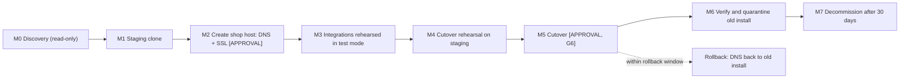

# Migration Plan — WordPress/WooCommerce to `shop.kcprintworks.com`

Status: **planning only. Nothing in this document has been executed.** The live WooCommerce site at
`kcprintworks.com` stays untouched and operational throughout development. Every step that changes
DNS, SSL, the live database, or payment configuration is marked **[APPROVAL]** and needs your
explicit go-ahead first (gates in [IMPLEMENTATION-PLAN.md](IMPLEMENTATION-PLAN.md) §2).

## 1. What we know and don't know

| Fact | Status |
|---|---|
| WordPress + WooCommerce runs today at `kcprintworks.com` on shared hosting | Known (owner) |
| Target: Next.js at `kcprintworks.com`; WordPress/WooCommerce (admin, checkout, REST, webhooks) at `shop.kcprintworks.com` | Approved |
| Hosting provider, control panel (cPanel?), PHP version, memory/process limits, WP-CLI and cron availability | **Unknown** |
| DNS provider and nameservers; where email (MX) is hosted; any CDN/proxy in front of the site | **Unknown** |
| Current SSL source and expiry; any CAA records | **Unknown** |
| WooCommerce/WordPress versions, HPOS state, active plugins, theme, permalink structure | **Unknown** (see [LIVE-SITE-DISCOVERY.md](LIVE-SITE-DISCOVERY.md)) |
| Current payment gateways, their mode, and the webhook URLs registered at Stripe (or others) | **Unknown** |
| External integrations using WooCommerce REST keys or webhooks (shipping, accounting, automation) | **Unknown** |

This environment cannot reach `kcprintworks.com` (blocked by network policy), so none of the unknowns
could be inspected. The discovery procedure in LIVE-SITE-DISCOVERY.md is read-only and designed for
you (or your host) to run and paste back.

## 2. Strategy: clone, then cut over (ADR-009)

We do **not** rename the live install in place. Renaming `kcprintworks.com` to `shop.kcprintworks.com`
would break the live store immediately and cannot be rehearsed.

Instead:

1. Build and test everything on a **staging clone** (own database, own hostname, Stripe test keys).
2. Stand up the final `shop.` host from a fresh clone, while the live site keeps taking orders.
3. At cutover, freeze orders on live for a short window, copy the final database to `shop.`, then point
   the apex at Next.js. The old install remains as a rollback target.

## 3. Phases

### M0 — Discovery (read-only; no approval needed)

Output: a filled-in inventory (plugins, versions, settings, DNS zone, SSL, gateways, webhooks, REST
keys, cron jobs, email). Procedure in LIVE-SITE-DISCOVERY.md. Also produce a **URL inventory**: the
live sitemap plus a crawl, used to build the redirect map and later to compare staging versus live.

### M1 — Staging clone (no change to the live site or DNS)

1. Take a full backup of files and database through the host's tooling; confirm it restores
   somewhere before relying on it.
2. Create the clone on a hostname that does **not** require touching production DNS. Options, in
   order of preference: the host's own staging feature or temporary URL; a separate cheap host; a
   local Docker environment loaded with a scrubbed export. A new staging subdomain such as
   `staging-shop.kcprintworks.com` is possible but is a DNS change **[APPROVAL]**.
3. Search-replace the site URL in the clone. Use `wp search-replace` (serialization-safe) or the
   migration plugin's equivalent; **never** a raw SQL find-and-replace, which corrupts serialized data.
4. Neutralize the clone before it runs: staging mode constant, `noindex`, HTTP basic auth, outgoing
   email redirected to a catch-all, **Stripe set to test keys** and webhooks removed, all live gateways
   disabled, scheduled actions that email customers or call external systems paused, scrubbed customer
   data where feasible.
5. Match PHP and plugin versions to production. Record differences.

Exit: staging serves the catalog, checkout runs in test mode, no outbound side effects.

### M2 — Create the `shop.` host **[APPROVAL]**

This is the first change to production DNS and must be approved with the exact records shown.

1. **Lower TTLs** on records that will change (to 300 s) at least 48 hours ahead.
2. Add DNS for `shop.kcprintworks.com`. On the same shared host this is typically an A record to the
   host's IP (or the CNAME the host specifies); the host then needs a matching subdomain/docroot.
3. **Do not change nameservers.** If the DNS zone also carries MX, SPF, DKIM, DMARC, or verification
   records, moving the zone risks breaking email. Add or edit individual A/CNAME records only. If a
   zone move is ever needed, replicate every record first and compare.
4. Issue SSL for the new hostname (§4) and deploy the fresh clone there, still `noindex` and behind
   basic auth until cutover.
5. Confirm the live apex is unchanged and still taking orders.

### M3 — Integrations rehearsed in test mode

Everything in §6 and §7 is configured against the `shop.` host using Stripe **test** mode: Stripe test webhook and Apple Pay domain
**[APPROVAL for each Stripe change]**, the Next.js server-to-server secret (`KCPW_HANDOFF_SECRET`), the revalidation hook, email provider, and
the Etsy sync service's site address (its own settings).

### M4 — Cutover rehearsal on staging

Run the full cutover runbook (§9) against staging with a fresh production export: measure the export
and import duration (this sets the freeze window), verify order and customer counts match, test the redirect map against the URL
inventory, and rehearse rollback.

### M5 — Cutover **[APPROVAL: G6]**

See the runbook in §9. Planned for a low-traffic window announced in advance.

### M6 — Verify and quarantine the old install

The old install is not deleted. It is made inert so it can never double-process anything: live Stripe
keys removed or plugin deactivated, WooCommerce webhooks deleted, scheduled actions and WP-Cron
disabled, outgoing email disabled, `noindex`, basic auth. It stays as a read-only rollback and
reference for at least 30 days.

### M7 — Decommission

After 30 days with no rollback need: archive a final backup offline, remove the old docroot and
database, remove old Stripe webhook endpoints and old API keys.

## 4. SSL and HTTPS

| Host | Certificate | Notes |
|---|---|---|
| `shop.kcprintworks.com` | Host-managed (AutoSSL / Let's Encrypt / host panel) | Domain validation usually requires the DNS record to already point at the host, so create DNS first (M2), then issue. Confirm auto-renewal and monitor expiry. |
| `kcprintworks.com`, `www.kcprintworks.com` | Issued automatically by the Next.js host after DNS points to it | Choose apex as canonical; `www` redirects to apex. |

Checks:

- **CAA records:** if any exist, they must permit the certificate authorities used by both hosts.
- **HSTS:** introduce gradually (`max-age` of 5 minutes, then a week, then longer) and **without**
  `includeSubDomains` or preload until every subdomain (including `mail.` or `cpanel.`) is audited,
  since HSTS on the apex can break them.
- **Mixed content:** scan staging for `http://` references in content, theme options, and plugin settings after
  the URL replacement.
- **WordPress settings:** `home` and `siteurl` both `https://shop.kcprintworks.com`; force HTTPS; TLS 1.2+
  only; security headers (CSP restricted to Stripe on checkout pages).
- Test with an external TLS scanner before and after cutover.

## 5. Redirects

The Next.js app keeps WooCommerce's public URL structure wherever it exists (decided in Step 1), so most
product and category URLs need **no redirect at all**. Use `trailingSlash: true` in Next.js to match
WooCommerce's trailing-slash URLs and avoid a redirect on every request.

The authoritative list is generated in Step 2 by diffing the live URL inventory (sitemap and crawl)
against Next.js routes. The patterns we expect to handle:

| Old URL (on `kcprintworks.com`) | After cutover | Type |
|---|---|---|
| `/product/{slug}/`, `/product-category/{slug}/`, `/shop/`, pages, posts | Same path, served by Next.js | none |
| `/cart/` | Next.js `/cart/` | none (Next route) |
| `/checkout/` | Next.js `/cart/` (WooCommerce checkout needs a handoff; a bare visit has an empty cart) | 302 |
| `/checkout/order-received/{id}/?key=…`, `/my-account/*` (including `view-order`) | Same path on `shop.kcprintworks.com`, query string preserved | 301 |
| `/wp-content/uploads/*` | Same path on the shop host (or its CDN) | 301 |
| `/wp-json/*`, `/wp-admin/*`, `/wp-login.php` | Same path on the shop host | 308/301 |
| `/xmlrpc.php` | Blocked | 403/410 |
| `/?add-to-cart={id}` (and `&variation_id=`) | Next.js route that adds a cart intent and goes to `/cart/` | 302 |
| `/?p={id}`, `/?s=…`, shop sort/filter query strings | Next.js equivalent, or canonical path | 301 |
| Yoast/WordPress sitemaps (`/sitemap_index.xml`, `/wp-sitemap.xml`), `/feed/` | Next.js sitemap; feeds redirected or retired | 301/410 |
| `/robots.txt`, `/favicon.ico` | Next.js | none |

Notes:

- The apex ends up on a different host, so these rules live in `next.config` redirects (data-driven from a
  versioned redirects file) or the Next.js host's edge config, never in the old `.htaccess`.
- The shop host serves `noindex` on everything except what must be crawlable; its non-checkout public pages
  redirect to the apex (`template_redirect` in `kcpw-core`, excluding wp-admin, REST, checkout, My Account,
  order-received, `wc-api`, and `.well-known`).
- Search Console: the apex property stays valid because the domain does not change, so **no Change of
  Address**. Submit the new sitemap, monitor coverage and 404s for 30 days, and compare the crawl to the
  pre-cutover inventory.

## 6. API connections

Review every connection that stores the site URL, a domain-bound key, or a callback.

| Connection | What changes | Notes |
|---|---|---|
| **Stripe** | Webhook endpoint URL, Apple Pay domain registration, return URLs, allowed domains | Test mode on staging first. Live changes only at cutover **[APPROVAL]**. Apple Pay is registered for the **shop** host. |
| **Other gateways (PayPal, etc.)** | Unknown until discovery | Return/IPN URLs change |
| **WooCommerce REST API keys** used by external tools (shipping, accounting, automation) | Base URL changes; keys may need regenerating | Inventory them under WooCommerce → Settings → Advanced → REST API |
| **WooCommerce webhooks** (Settings → Advanced → Webhooks) | Delivery URLs of the receivers stay; the source host changes | Receivers that allowlist the sender hostname need updating |
| **Etsy sync service** (ExportYourStore / Nembol) | It connects to the WooCommerce site by address or API key | Check its settings after the move; it may need the new host, and must not create duplicate products on the new site |
| **Premium plugin licenses and WooCommerce.com subscriptions** | Often bound to the site URL | Check each; deactivate on the old URL and reactivate on the new where required |
| **Jetpack or other cloud-connected plugins** | Connection is tied to the URL | Plan a reconnect; avoid disconnecting the live site early |
| **Shipping and tax services** | Domain-bound API keys or origin allowlists | Add the shop host |
| **Email** (SMTP/API provider, SPF/DKIM/DMARC) | Sender domain unchanged; the sending host changes | Authenticate before launch; point the new host at the provider |
| **Google/Meta** (Analytics, Tag Manager, Merchant Center feeds, Pixel, Search Console) | Feed URLs and domain verification | Product feeds should come from the storefront or WooCommerce data, to be decided |
| **CAPTCHA / maps keys** | Allowed-domain lists | Add `shop.` where forms or maps still run there |
| **Storefront ↔ `kcpw-core`** | New HMAC secrets | Per environment; rotated at cutover |
| **Revalidation webhook** (WordPress → Next.js) | New | `https://kcprintworks.com/api/revalidate` from the shop host |

## 7. Webhook endpoints

Read the exact URL from each plugin's settings screen. Do not guess it from memory, because paths
differ between plugin versions.

| Source → receiver | Old (today) | New (after cutover) | Verified by |
|---|---|---|---|
| Stripe → WooCommerce Stripe plugin | `https://kcprintworks.com/…` (as shown in the plugin or Stripe Dashboard) | `https://shop.kcprintworks.com/…` (as shown in the plugin) | Stripe signature |
| Etsy sync service → WooCommerce | its own settings point at the WooCommerce site | **must be updated to the new host if it uses the site address** (check the service's settings) | the service |
| WordPress → Next.js revalidation | none | `https://kcprintworks.com/api/revalidate` | HMAC + timestamp |
| WooCommerce webhooks to third parties, if any | listed in discovery | same receivers, new sender host | per receiver |

Rules:

- **Staging** gets its own endpoints and secrets in Stripe test mode; production secrets are never reused. Do not point a second WooCommerce copy at the sync service while the live one uses it.
- **Overlap:** at cutover, register the new live Stripe endpoint first, verify a delivery, and only then
  remove the old endpoint. Never leave the old install able to act on events (§3 M6).
- Webhook paths must bypass page caches, CDN caching, bot challenges, and the host's web application
  firewall. Shared-host WAFs (ModSecurity or Imunify rules) sometimes block signed POST bodies; add allow rules
  and test with real test-mode deliveries.
- Both endpoints respond quickly and do real work asynchronously.

## 8. Checkout and session behavior

| Topic | Behavior |
|---|---|
| Where state lives | Cart intents in the browser (`localStorage`) on the apex. The WooCommerce cart/session cookies exist only on `shop.` |
| Cookie scope | WooCommerce session and login cookies are **host-only**: do not set a `Domain=.kcprintworks.com` attribute. This keeps them off the apex and Next.js host and avoids cache fragmentation |
| Handoff | Top-level `GET` navigation from the apex to `shop.` with a single-use token; `shop.` sets its own first-party session cookie. Same-site, so `SameSite=Lax` works |
| Stripe redirects | 3-D Secure and wallet returns are top-level navigations back to `shop.` and carry Lax cookies; the order-received URL also works without a cookie by using the order key |
| Session lifetime | WooCommerce guest sessions last about 2 days by default; Next.js intents last until the browser clears them. Each handoff rebuilds the WooCommerce cart from the intents |
| Customers mid-cart at cutover | Carts and logged-in sessions on the old install do not follow the customer to the new host; schedule off-peak and tell customers beforehand |
| Logged-in customers | Passwords and accounts migrate with the database; users sign in again on `shop.`; account links in the storefront point to `shop.` |
| In-flight payments | **Zero** at cutover: before freezing, confirm no orders are waiting on payment confirmation (`pending` or `on-hold`) and no PaymentIntents are in a processing or action-required state |
| Old return URLs | Any PaymentIntent created on the old host carries a return URL on the apex; the redirect map sends `/checkout/order-received/*` to `shop.` so late returns still land correctly |
| Caching | Cart, checkout, My Account, and `wc-api` bypass every cache layer (page cache plugin, CDN) |
| Public pages on `shop.` | Redirect to the apex except the paths listed in §5 |
| CORS | Not needed: browsers never call WordPress APIs cross-origin; server-to-server and navigations only |

## 9. Cutover runbook (outline; finalized in M4) **[APPROVAL: G6]**

| When | Step | Owner |
|---|---|---|
| T−7 d | Freeze plugin and theme changes on live; confirm backups restore; announce the window | Owner/dev |
| T−48 h | Lower TTLs to 300 s **[APPROVAL]** | Owner |
| T−1 h | Final rehearsal checks; Next.js production build on the final domain candidate (not yet routed) | Dev |
| T−0:00 | Put live in maintenance mode that blocks checkout; record order/customer counts | Dev |
| T+0:05 | Confirm no pending payments or unsettled PaymentIntents | Dev |
| T+0:10 | Final full backup, then database export from live | Dev |
| T+0:20 | Import into the `shop.` install; search-replace URLs; flush caches; verify counts equal | Dev |
| T+0:35 | Switch the `shop.` install to production mode: live Stripe keys entered by the owner, new live webhook registered and a test event delivered, Apple Pay domain registered **[APPROVAL for each Stripe change]** | Owner/dev |
| T+0:45 | Point the apex and `www` at the Next.js host **[APPROVAL]**; verify TLS | Owner |
| T+0:50 | Smoke tests: browse, personalize, handoff, pay a low-value order, refund it, confirm emails | Dev |
| T+1:10 | Remove `noindex`/basic auth from production paths; submit sitemap; remove maintenance from the old install and apply the quarantine (§3 M6) | Dev |
| T+1 d to T+30 d | Daily reconciliation, 404 and coverage monitoring, error review | Dev |

**Rollback.** Within the first 2 hours with no new orders placed on `shop.`: repoint the apex DNS to the old
install, re-enable its quarantine exceptions, and restore the old Stripe endpoint. After new orders exist on
`shop.`, rollback needs an order merge; decide before cutover who authorizes it and how orders are exported
and re-imported.

## 10. Shared-hosting risks and checks

| Risk | Check or mitigation |
|---|---|
| Concurrent PHP process limits make checkout and sync compete | Sync runs one batch at a time from cron; load test in Step 10; upgrade path to managed WordPress or a VPS if it fails (risk R15) |
| No WP-CLI, shell, or system cron | Use the panel's cron to run the Action Scheduler runner; otherwise the low-concurrency fallback in ETSY §11.2 |
| Low memory or execution time breaks big imports | Chunked exports and imports; host support request ahead of cutover |
| Host WAF blocks webhooks | Allow rules and delivery tests (§7) |
| Outbound HTTPS restricted | Confirm cURL to Stripe (and the sync service) works from the host |
| Email deliverability from shared IPs | Transactional provider with SPF/DKIM/DMARC |
| Older PHP | The Stripe plugin requires WordPress 6.9 and PHP 7.4 or newer; our plugins target PHP 8.2. If the host cannot provide it, the host changes (decided in Phase 0) |
| Shared inode, disk, or backup limits | Check quotas before cloning |

## 11. Inputs I need to finalize this plan

Hosting provider and plan (and whether it offers staging and WP-CLI), DNS provider, whether email is
hosted on the same account, whether a CDN or Cloudflare is used, current SSL provider, active payment
gateways and their mode, external tools using WooCommerce keys, premium plugin licenses, and a preferred
cutover window. The first deliverable is the discovery output described in LIVE-SITE-DISCOVERY.md.
