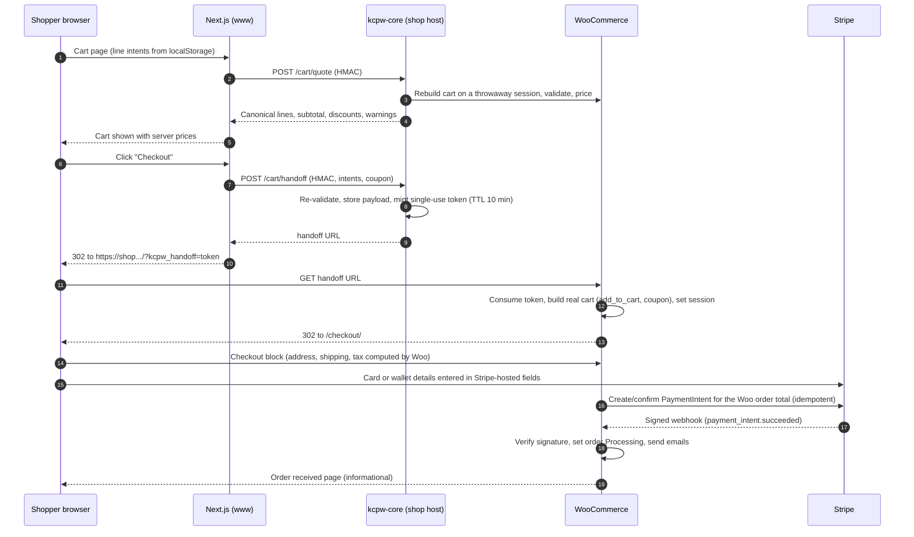

# Payments — Stripe

Status: **proposed**; the checkout topology needs your sign-off (ADR-002 in
[DECISIONS.md](DECISIONS.md)). No Stripe account setting is changed until the gates in
[IMPLEMENTATION-PLAN.md](IMPLEMENTATION-PLAN.md) are approved. All build and test work uses
Stripe **test mode on staging**.

## 1. Decision summary

**Use the official WooCommerce Stripe Payment Gateway plugin as the payment engine, and render
the checkout on the WooCommerce host.** The Next.js storefront handles browsing and the cart,
then hands the shopper to WooCommerce checkout through a validated, single-use handoff.

Why this and not a native Next.js checkout:

- Your brief says to use the official plugin unless something is demonstrably better supported.
  Nothing I found is. The plugin's documentation that I could reach (repository and `readme.txt`)
  covers WooCommerce's own checkout; I found **no documentation endorsing its payment flow when
  driven from a separate headless frontend.** Re-implementing the plugin's client-side payment
  handling in Next.js would mean tracking an undocumented, fast-moving interface.
- It gives card, Apple Pay, Google Pay, webhooks, refunds, and order status updates from code
  that Stripe and WooCommerce maintain.
- WooCommerce stays the single place that calculates shipping, tax, discounts, and totals, so
  Stripe is always charged the WooCommerce order total.

### Options compared

| | A. Hybrid: Next.js storefront, WooCommerce-hosted checkout with official plugin **(recommended for v1)** | B. Headless checkout: Next.js UI + Woo Store API + plugin's payment data | C. Custom: Stripe-hosted Checkout or Payment Element driven by our own plugin |
|---|---|---|---|
| Payment code we own | Handoff only | Client payment glue (undocumented for this use) | Everything: session creation, webhooks, refunds, idempotency |
| Apple Pay / Google Pay | Provided by plugin on the shop host | Needs the plugin's JS contract reproduced | Provided by Stripe; domain registration on our host |
| Refund and status sync | Plugin | Plugin | We build and maintain |
| Checkout look and feel | WooCommerce block checkout, themed to brand | Fully custom | Stripe-hosted page (limited branding) or fully custom |
| Risk of breakage on plugin update | Low (supported surface) | **High** | N/A (but our own bugs) |
| Effort | Lowest | Medium, ongoing | Highest |

C is the documented contingency (§12). B is rejected for v1. Both can be revisited after launch
if the checkout look and feel proves unacceptable.

## 2. Requirement coverage

| Requirement | How it is met | How it is verified |
|---|---|---|
| Credit and debit cards | Stripe plugin, Stripe-hosted card fields | Test cards in §11 |
| Apple Pay, Google Pay where supported | Plugin express checkout / payment-method support; Apple Pay domain registered for the **shop host** (not `www`) | Real iOS Safari and Android Chrome devices in test mode |
| Secure HTTPS | TLS everywhere, HSTS, CSP restricted to Stripe domains on checkout | Header scan, SSL Labs |
| Test mode before production | Staging uses only test keys and a separate webhook endpoint; live switch is gate G6 | Checklist in §10 |
| Accurate totals (shipping, tax, discounts, personalization) | WooCommerce computes everything; the client never supplies a price (§4, §5) | Totals matrix test (§11.3) |
| Automatic order status updates | Plugin updates status from verified Stripe events | Webhook tests (§11.2) |
| Payment confirmation emails | WooCommerce "Processing order" email, branded; Stripe receipts off to avoid duplicates | Mailpit on staging; deliverability test |
| Refunds | WooCommerce admin refunds call Stripe via the plugin; Dashboard-initiated refunds sync back via webhook | Refund tests (§11.4) |
| Secure webhooks | Stripe signature verification in the plugin, raw-body, secret per environment | Replay and bad-signature tests |
| No duplicate charges or orders | Layered protections (§7), each tested | Duplicate tests (§11.2) |
| Never store card details | Stripe-hosted fields; we persist only Stripe IDs | Code review; DB and log scan for PAN patterns |
| Redirect is not proof of payment | Order status changes only on server-side verification (§6) | Tests that force a success redirect with no payment |

## 3. Flow

Notes:

- The shopper sees WooCommerce's shipping and tax calculation only at checkout, where the address
  is known. The Next.js cart shows items, option charges, discounts, and "shipping and tax
  calculated at checkout".
- A new handoff **replaces** the WooCommerce cart each time, so Next.js remains the source of
  truth for cart contents until payment.
- The payment return path (3-D Secure, wallets) stays inside the plugin's own flow; we do not
  intercept the return URL in v1 (see §8).

## 4. Cart handoff specification

| Endpoint | Auth | Purpose |
|---|---|---|
| `POST /kcpw/v1/cart/quote` | HMAC (server-to-server only) | Validate and price line intents without creating a persistent cart |
| `POST /kcpw/v1/cart/handoff` | HMAC | Validate again, persist a handoff, return a URL |
| `GET /?kcpw_handoff={token}` | Token | Consume the handoff and redirect to checkout |

Handoff token properties:

- 256-bit random value; only a hash is stored in `kcpw_handoff`; the payload is stored
  **server-side**, not in the URL.
- TTL 10 minutes; single use. A second use in the same browser session redirects to checkout
  without rebuilding; from another session it is rejected.
- Validation, performed twice (quote and handoff) using WooCommerce's own logic:
  product exists and is purchasable; variation matches the parent and attributes; quantity
  limits; stock if stock-managed; coupon validity and usage limits; every personalization value
  re-validated against the product's schema (§5).
- **Prices are never accepted from the client.** Any price field in a request body is rejected.
- Failure responses are structured (`out_of_stock`, `invalid_option`, `coupon_invalid`,
  `unavailable`) so the Next.js cart can explain the problem. It never silently adjusts what the
  shopper is buying.

## 5. Personalized product options

Storage: a per-product option schema in product meta (managed in WC admin), exposed in the
storefront DTO.

| Field type | Rules |
|---|---|
| Text / textarea | Required flag, min/max length, allowed-character policy, profanity filter hook |
| Select / radio / swatch | Allowed values fixed by schema |
| Checkbox | Boolean; optional price adder |
| Image upload (only if needed; see open questions) | Allowed MIME types and size; stored outside any public directory index with random names; extension and content type verified server-side; served only to authenticated admins |

Rules:

1. **The schema, not the request, decides what is valid and what it costs.** Option price adders
   (flat or percentage) are applied by a `kcpw-core` cart-item pricing hook using values
   from the schema. A tampered client value cannot change a price.
2. Validated values are stored as cart-item data and become **order-item meta** with readable
   labels, so they appear in WooCommerce admin, packing slips, and emails.
3. Item-meta labels intentionally match the labels used for imported Etsy personalization, so
   fulfillment sees one consistent format.
4. Output is escaped everywhere it is rendered (storefront, admin, emails, PDF).

## 6. Order status rules (redirect is never proof)

| Event | Source of truth | Order result |
|---|---|---|
| Shopper reaches the order-received page | Informational only | No status change |
| `payment_intent.succeeded` verified | Stripe signed webhook, or plugin's direct PaymentIntent retrieval on return | Processing; emails sent |
| `payment_intent.payment_failed` | Verified webhook | Failed; shopper can retry |
| `charge.refunded` | Verified webhook | Refund recorded; status updated |
| `charge.dispute.created` | Verified webhook | On-hold plus admin alert (manual runbook) |
| Success redirect with no verified Stripe event | None | Stays Pending; a test forces this case |

Further rules:

- Fulfillment staff work only from **Processing** orders.
- The storefront never marks an order paid. Any "thank you" content on `www` is rendered
  only after a server-to-server order lookup returns a paid status.
- The nightly reconciliation job compares each Stripe-paid WooCommerce order against its
  PaymentIntent (amount, currency, status) and alerts on any mismatch.
- Unpaid pending orders are auto-cancelled by WooCommerce's standard "hold stock" timeout.

## 7. Duplicate-charge and duplicate-order protection

Defense in depth, each layer separately tested (§11.2):

| Layer | Mechanism |
|---|---|
| Stripe API calls | The plugin sends idempotency keys with PaymentIntent requests (confirm on staging by inspecting Stripe request logs) |
| Order creation | One WooCommerce order per checkout session; resubmission reuses the pending order |
| UI | Pay button disabled on submit (plugin behavior); handoff button debounced |
| Handoff | Single-use token; repeated clicks do not create duplicate carts |
| Webhooks | Events are handled idempotently (re-delivery of the same event does not double-apply status or stock); verify by replaying each event type twice |
| Concurrency | Same checkout in two tabs and back-button resubmission result in exactly one charge |
| Reconciliation | Nightly check for two orders sharing one PaymentIntent, or one order with two successful charges |

If any test shows a gap in the plugin's own behavior, we fix it with a guard in `kcpw-core`
(for example, an order-level lock) or file an upstream issue and ship the guard meanwhile.

## 8. Webhooks

- Endpoint is the plugin's webhook URL on the **shop host**, outside the Next.js app, the CDN
  page cache, and any bot-challenge rule. One endpoint per environment; test and live
  secrets are separate.
- Verification uses the Stripe signature header on the raw body. We rely on the signature, not
  an IP allowlist.
- Registering the endpoint changes Stripe account configuration, so it is done by you (or with
  your approval) in test mode first. I will provide the exact event list from the installed
  plugin version at that time rather than guessing it now.
- Monitoring: the Stripe Dashboard's webhook delivery failures plus the daily check in
  [ARCHITECTURE.md §8](ARCHITECTURE.md#8-observability-and-operations).

**Return-URL spike (Step 3).** After payment the shopper lands on the WooCommerce
order-received page. The nicer experience is to continue on `www`, but redirecting from the
return URL could interfere with the plugin's own verification. v1 keeps the WooCommerce page
(branded) and links back to `www`. The link carries a signed order reference; `www` confirms the
order status server-to-server before clearing the cart. The spike tests whether a filtered
`get_return_url` is safe; if it is not, v1 keeps the simple behavior.

## 9. Refunds and emails

**Refunds**

- Full and partial refunds from the WooCommerce order screen call Stripe through the plugin.
- Refunds started in the Stripe Dashboard return through the verified webhook and appear as
  WooCommerce refunds.
- Imported Etsy orders use an internal "Paid on Etsy" payment method with refunds **disabled**, so
  an Etsy order can never be refunded through Stripe.
- Test: full, partial, multiple partial, over-refund attempt, refund from Dashboard.

**Emails**

- WooCommerce transactional emails (new order, processing, completed, refunded), branded with the
  palette. Stripe's own receipts are turned off to avoid duplicates (a decision for you to confirm).
- Sent through a transactional email provider with SPF, DKIM, and DMARC on the sending domain.
  WordPress's default mail transport is unreliable for this.
- Email templates are tested for personalization display and for contrast of the accent button.

## 10. Test mode to production

1. Install the plugin on **staging** only; connect with Stripe **test** keys supplied by you.
   Prefer restricted keys if the plugin version supports them.
2. Enable only: card, Apple Pay, Google Pay. Link and buy-now-pay-later methods stay off unless
   you ask. Local payment methods stay off.
3. Register the staging webhook endpoint in test mode. Register the Apple Pay domain for the
   staging shop host (the plugin automates this, but it is still a Stripe configuration change).
   **Both are changes to your Stripe account, so they happen only with your approval**, in test
   mode, and I will list exactly what will be created before it is done.
4. Run the full test plan (§11). Step 4 of the plan ends with a written readiness report.
5. **Gate G6 (explicit approval) before any live change**: live keys, live webhook endpoint, live
   Apple Pay domain registration for the production shop host, statement descriptor review, first
   live order smoke test with a refundable low-value purchase, and DNS cutover. The rollback plan
   is written before the gate.

## 11. Test plan

### 11.1 Payment methods (Stripe test mode)

| Case | Input | Expected |
|---|---|---|
| Success | `4242 4242 4242 4242` | Order Processing; confirmation email |
| Generic decline | `4000 0000 0000 0002` | Order not paid; clear error; retry works; one order |
| 3-D Secure required | `4000 0025 0000 3155` | Authentication step; success only after verified payment |
| Abandon at 3DS | Close tab | Order stays Pending, auto-cancels on timeout |
| Apple Pay | Real iPhone/Mac Safari, test mode | Success |
| Google Pay | Real Android Chrome, test mode | Success |

### 11.2 Duplicates and webhooks

Double-click Pay; two tabs; back-button resubmit; network drop mid-confirmation; webhook
arriving **before** and **after** the shopper lands on the confirmation page; replay of each
webhook event twice; bad signature (must be rejected); success redirect with no payment (must stay
Pending).

### 11.3 Totals matrix

Combinations of: shipping zone and method, tax class and region, percentage and fixed coupons,
free shipping thresholds, personalization with price adders (flat and percent), variations,
quantity above 1, and rounding edge cases. Assert **WooCommerce order total = PaymentIntent
amount = emailed total** in each case.

### 11.4 Refunds

Full, partial, multiple partial, over-refund blocked, Dashboard-initiated refund synced back,
refund email, stock behavior for stock-managed items.

### 11.5 Personalization and tampering

Max-length and illegal-character text; required fields missing; tampered option value, tampered
price field, tampered variation ID, quantity manipulation, expired and reused handoff token,
upload abuse (if uploads exist). The expected result in every case is rejection with a structured
error and no order created.

## 12. Contingency: Stripe-hosted Checkout driven by our code

Adopt only if ADR-002 fails its acceptance criteria (the plugin cannot support the handoff, or the
checkout experience is rejected). If we do, we own these invariants:

1. **Server-side price validation:** build Stripe `line_items` from a WooCommerce order calculated
   by WooCommerce, never from the client. Tax and shipping come from WooCommerce as explicit
   lines (avoids double taxation by running Stripe Tax and WooCommerce tax together).
2. **Order first:** create a Pending WooCommerce order, then create the Checkout Session with
   `client_reference_id` and metadata holding the order ID and key.
3. **Idempotency:** idempotency key `order-{id}-v{revision}` on Session creation; expire a Session
   when the cart changes.
4. **Webhook handling:** verify the signature on the raw body; store each processed `event.id` in a
   table with a unique constraint; take a row lock on the order; ignore duplicates.
5. **Amount check:** `amount_total` and currency must equal the order total, else On-hold plus alert.
6. **Redirect is informational:** `success_url` shows a "confirming payment" state and polls the
   order status.
7. **Refunds:** issued from WooCommerce to Stripe with idempotency keys, plus a webhook that records
   Dashboard-initiated refunds.
8. **Reconciliation:** the same nightly job as the primary design.

## 13. Known limitations of v1

- Apple Pay and Google Pay buttons appear on the WooCommerce checkout, not on Next.js product or
  cart pages (the wallet domain is the shop host). Express buttons on `www` would need option C.
- The checkout is a themed WooCommerce page, not part of the Next.js design system.
- Customer accounts, saved cards, and order history are served by WooCommerce My Account on the
  shop host. v1 is guest-checkout-first.

## 14. Research notes

| Fact | Source | Confidence |
|---|---|---|
| Plugin supports cards, Apple Pay, Google Pay, Link and many local/BNPL methods | Plugin `readme.txt` on the repository `trunk` branch, read 2026-10-13 | High |
| `readme.txt` stable tag 11.0.1, WordPress ≥ 6.9, PHP ≥ 7.4; changelog shows 11.1.0 | Same | Medium (stable tag and changelog differ; pin the version actually tested) |
| Legacy checkout removed in plugin 10.0.0; Optimized Checkout Suite is the default experience | Same | High |
| Plugin does not document headless/Store API use of its payment flow | Absence in the sources I could reach | Medium. Verify with a Step 3 spike if you want B reconsidered |
| Webhook event list, restricted-key support, idempotency-key behavior | Not retrievable here | To verify against the installed version in Step 3 |
